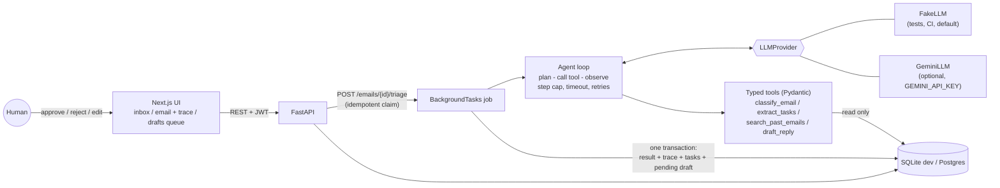

# Inbox Triage Agent

A small web app where an AI agent reads emails, **classifies** them, **extracts action items**, and **drafts replies**.
Nothing is ever sent. Every draft lands in a pending queue and a human must approve, reject or edit it.

It is a portfolio project: the goal is a *correct, tested, honest* agent pipeline, not a finished product.
Read the [Limitations](#limitations-and-not-built-yet) section before judging what it can do.

## Safety design: human approval, no auto-send

- **There is no send path.** The codebase has no SMTP/Gmail transport, no "sent" status and no `/send` endpoint
  (a test asserts the draft status set is exactly `pending | approved | rejected`).
- **Drafts are a queue.** The agent's `draft_reply` tool only writes a `pending` draft row. `approve` and `reject` are
  explicit, authenticated human actions; both are terminal. Editing a draft never approves it.
- **Transitions are race-safe.** Approve/reject/edit are compare-and-set updates guarded by `status = 'pending'`,
  so a double click or two reviewers cannot flip a decided draft (the loser gets `409`).
- **One draft per email, enforced by the database** (`UNIQUE(email_id)`), in addition to application-level idempotency.
- **Policy guard inside the tool.** `draft_reply` refuses for spam and newsletters and before the email is classified.
- **Untrusted input.** Email text is data; the system prompt tells the model not to follow instructions in it.
  The real defence is structural: the model can only call four tools, none of which can send or delete anything.
- **Failures leave no half-state.** A failed run stores only its error and trace; partial classifications, tasks
  and drafts are never persisted.

## Architecture



**Agent loop** (`backend/app/agent/loop.py`): the model returns one tool call per turn. Every argument set is validated with
Pydantic (`extra="forbid"`) before the tool runs. Invalid arguments, an unknown tool, or a tool refusal are fed back to the
model **once per run**; a second one fails the run safely. Provider timeouts / 429 / 5xx are retried with capped exponential
backoff; malformed output is not retried. There is a hard step cap and a wall-clock budget. The loop never raises: it returns
a run with `error_code` (`llm_timeout`, `malformed_output`, `invalid_tool_arguments`, `tool_error`, `step_limit`, `timeout`,
`no_classification`).

**Observability:** every run stores a trace (`step, tool, args, result, error, latency_ms`, including failed provider calls and
retries). The API returns it with the email and the UI renders it on the email detail page.

**Idempotency:** `POST /emails/{id}/triage` atomically claims the email (`queued -> running -> completed|failed`).
A repeat call after completion, or while running, is a no-op (`200`, `started: false`). A `failed` email can be retried.

## Stack

Backend: FastAPI, Pydantic v2, SQLAlchemy 2, SQLite (dev) / Postgres via `DATABASE_URL`, PyJWT, stdlib scrypt.
Agent: own small tool-calling loop (no agent framework), `google-genai` for the optional Gemini provider.
Frontend: Next.js (App Router) + TypeScript, plain CSS. Tests: pytest + FastAPI `TestClient`.

## How to run

### Backend (Python 3.11+)

```bash
cd backend
python -m venv .venv && source .venv/bin/activate      # Windows: .venv\Scripts\activate
pip install -r requirements-dev.txt
cp ../.env.example .env                                  # optional; defaults work for dev
uvicorn app.main:app --reload --port 8000                # docs at http://localhost:8000/docs
```

Default provider is `fake` (deterministic keyword rules; no network). To use a real model:

```bash
pip install -r requirements-gemini.txt
export LLM_PROVIDER=gemini GEMINI_API_KEY=...            # the key is never logged or committed
```

### Frontend (Node 20+)

```bash
cd frontend
npm install
npm run dev                                              # http://localhost:3000
```

Register an account on `/login` (the **first** account becomes admin), click **Load sample inbox**, then **Triage** an email.

### Docker

```bash
cp .env.example .env        # set JWT_SECRET
docker compose up --build   # Postgres + backend (:8000) + frontend (:3000)
```

## Tests and evals

```bash
cd backend && python -m pytest -q          # unit + API tests, all offline, FakeLLM only
python evals/gate.py --provider fake       # from the repo root: eval regression gate (what CI runs)
python evals/run_evals.py                  # same eval, full report incl. confusion tables
```

Tests cover: schemas and tool-argument validation, the agent loop (success, invalid args then recovery, repeated invalid
args, step cap, wall-clock timeout, tool error, LLM timeout with capped backoff, malformed output, provider crash), the Gemini
translation layer (with a stub client, no key or network), idempotent triage, failure recording and retry, draft state
transitions, auth (hashing, JWT expiry/forgery, role check), and the REST endpoints.

### About the eval numbers (read this)

`evals/dataset.json` has 30 synthetic, clearly fictional emails (reserved `.test` domains), labeled by the author with expected
category, urgency and whether a reply is needed. With the default **FakeLLM**, the "model" is a small set of keyword rules
written by the same person who wrote the dataset. The accuracy it prints therefore **tests the pipeline** (tool loop,
validation, trace, scoring, the gate) and says **nothing about real-model quality**. The runner labels its own output that way.
It currently scores roughly category 0.93 / urgency 0.77 / reply-needed 0.90 and misses some cases on purpose-built hard
examples; `evals/thresholds.json` holds the floors CI enforces.

Real-model numbers must be measured separately: `python evals/run_evals.py --provider gemini` (needs `GEMINI_API_KEY`).
That has **not** been run for this repo, and 30 emails is too few to support strong claims even when it is.
`gate.py --provider gemini` refuses to pass until a human adds measured thresholds for it.

## API summary

| Method | Path | Notes |
| --- | --- | --- |
| POST | `/auth/register`, `/auth/login`, GET `/auth/me` | JWT bearer; first user is `admin` |
| POST | `/emails` | structured fields or `raw_text` (pasted email) |
| POST | `/emails/seed` | admin only; loads 8 fictional sample emails (idempotent) |
| GET | `/emails`, `/emails/{id}` | detail includes triage result, tasks, draft, **trace** |
| POST | `/emails/{id}/triage` | idempotent; runs in the background; retry allowed after `failed` |
| GET | `/drafts?status=` | `pending | approved | rejected` |
| POST | `/drafts/{id}/approve`, `/reject` | `409` if already decided |
| PATCH | `/drafts/{id}` | edit text of a pending draft |

## Measured results (live model)

Run on 2026-10-16 with `gemini-3.1-flash-lite` over the 30 synthetic, author-labeled emails (temperature 0, one run, 0 failed runs; raw output in `evals/reports/`):

| Field | Accuracy |
|---|---|
| category | 0.967 (29/30) |
| urgency | 0.767 (23/30) |
| needs_reply | 0.900 (27/30) |

How to read this: n = 30 is small and the labels were written by the author, so one email moves a score by 3 points and some labels are debatable. The urgency errors are all over-escalation (the model rated emails higher than the label, never lower); for example it rated a phishing-style "verify your account" email as high urgency, while the label policy says spam is low. This is a single run, so treat the numbers as a baseline, not a benchmark. The FakeLLM numbers above test only the pipeline.

Two defects were found only by running against the real API and are fixed (with a regression test for the second): the default model name had been retired for new users, and newer Gemini models reject a function call that is echoed back without its thought signature (HTTP 400), so the provider now replays the original response part.

## Limitations and not built yet

- **No Gmail / OAuth.** Emails come from the seeded sample inbox or pasted text. A read-only Gmail connector is a documented
  future step; nothing for it exists in the code.
- **FakeLLM numbers are not model quality** (see above). Gemini support is implemented and unit-tested against a stub, but I have
  not validated it against the live API or measured its accuracy.
- **Nothing is sent, by design.** "Approved" only records a human decision; actually delivering mail is out of scope.
- **SQLite for dev; no migrations.** Tables are created with `create_all` at startup. Postgres is supported via `DATABASE_URL`
  and used in `docker-compose.yml`, but is not part of the automated tests. Alembic is the obvious next step.
- **Background work is in-process** (`BackgroundTasks`). A crash mid-run leaves the row `running` (no lease/heartbeat recovery),
  and there is no queue, worker pool or rate limiting for LLM calls.
- **One provider call can still hang up to its timeout.** The loop enforces a wall-clock budget between calls and passes a timeout
  to the provider, but it cannot forcibly cancel a blocked synchronous call.
- **Auth is minimal.** No refresh tokens, password reset, email verification, lockout or rate limiting; the JWT lives in
  `localStorage` in the demo UI. Two roles only (`admin`, `member`). Any authenticated user can approve any draft.
- **Not multi-tenant.** All users share one inbox.
- **Prompt injection** is mitigated structurally (the tool set cannot send or delete), not solved.
- **Frontend is deliberately thin:** no component tests, no pagination, no websocket (it polls while triage is running).
  Types in `frontend/lib/types.ts` are maintained by hand.
- `next build` was not run on the machine where this was authored (low memory); CI runs lint, typecheck and build.

## How this was built

Built with AI coding assistance (Claude Code) from a written specification, then reviewed by the owner. The architecture,
safety rules and test plan were specified up front; the AI generated most of the code and tests, which were run and checked
against the behaviour described here. Treat it as a reviewed scaffold: read the code before relying on any claim in this file.

## Repository layout

```
backend/app/agent/     loop.py, tools.py, providers.py (FakeLLM + GeminiLLM), schemas.py, errors.py
backend/app/services/  triage.py (idempotent job), drafts.py (state machine), emails.py
backend/app/api/       auth, email and draft routes
backend/tests/         pytest suite
evals/                 dataset.json, run_evals.py, gate.py, thresholds.json
frontend/              Next.js app (inbox, email detail + trace, drafts queue)
```
